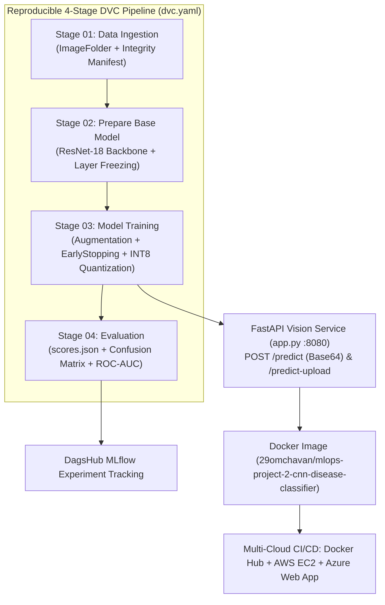

# Production MLOps Project 02: Deep Learning + Computer Vision Disease Detection System

[](https://github.com/29OmChavan/mlops-project-2-cnn-disease-classifier/actions)
[](https://dagshub.com/29omchavan/mlops-project-2-cnn-disease-classifier)
[](https://hub.docker.com/r/29omchavan/mlops-project-2-cnn-disease-classifier)

A production-grade **Deep Learning & Computer Vision MLOps System** for automated 4-class pathology/microscopy disease classification (`Coccidiosis`, `Healthy`, `Newcastle_Disease`, `Salmonella`), built with **PyTorch ResNet-18 Transfer Learning**, **DVC (`dvc.yaml`)** pipeline versioning, **DagsHub MLflow** tracking, **Dynamic INT8 Model Quantization**, **FastAPI** serving, **Docker**, and **Multi-Cloud (AWS + Azure) GitHub Actions CI/CD**.

---

## System Architecture



---

## Documentation Index (Team Role Simulation)

* **[Complete Step-by-Step Implementation Guide](docs/IMPLEMENTATION_GUIDE.md)** — Full walkthrough of CNN math, Residual skip connections, Transfer Learning, DVC DAGs, and code snippets.
* **[Data Engineer: Computer Vision Data & DVC Spec](docs/01_DATA_AND_DVC_SPEC.md)** — Pathology class biomarkers, augmentation transforms, and DVC DAG caching mechanics.
* **[ML Researcher: CNN Theory, Experiment Log & Model Card](docs/02_EXPERIMENT_LOG_AND_MODEL_CARD.md)** — 2D cross-correlation equations, BatchNorm, ResNet gradient derivation, layer freezing ablation, and INT8 quantization benchmarks.
* **[ML & DevOps Engineer: Multi-Cloud (AWS vs. Azure) Runbook](docs/03_MULTICLOUD_DEPLOYMENT_RUNBOOK.md)** — Side-by-side architectural comparison of AWS ECR/EC2 vs. Azure ACR/Web App + incident post-mortem.
* **[Changelog](CHANGELOG.md)** — Release history (`v1.0.0`).

---

## Quickstart

```bash
# 1. Install dependencies
python -m venv .venv
.\.venv\Scripts\Activate.ps1
pip install -r requirements.txt

# 2. Reproduce the entire 4-stage DVC pipeline
dvc repro
# (Or run `python main.py`)

# 3. View DVC tracked evaluation metrics
dvc metrics show

# 4. Run unit & integration tests
pytest tests/ -v

# 5. Launch FastAPI Computer Vision UI & REST Server (http://localhost:8080)
python app.py
```
