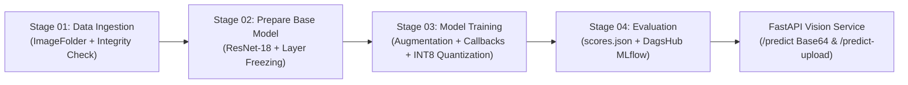

# Complete Step-by-Step Implementation Guide: Project 02 · Deep Learning CNN Disease Detection System

> **Purpose of this Document**: This guide explains every step, mathematical equation, architectural pattern, and critical code implementation used to build **Project 02** following Krish Naik's *End-to-End Deep Learning Project Using MLOps DVC Pipeline With Deployments Azure and AWS*, Andrew Ng's *CNN & ResNet Lectures*, and Sentdex's *Neural Networks from Scratch*.

---

## 1. End-to-End DVC + MLflow Architecture



---

## 2. Step-by-Step Implementation Walkthrough

### Step 1: Understanding 2D Convolution & Residual Connections from Scratch (`prepare_base_model.py`)
Before applying Transfer Learning, we implemented:
1. **`conv2d_from_scratch(image, kernel, stride, padding)`**: Computes 2D discrete cross-correlation over spatial patches:
   ```python
   h_out = (h_in - k_h) // stride + 1
   w_out = (w_in - k_w) // stride + 1
   for i in range(h_out):
       for j in range(w_out):
           patch = image[i * stride : i * stride + k_h, j * stride : j * stride + k_w]
           out[i, j] = np.sum(patch * kernel)
   ```
2. **`FirstPrinciplesResidualBlock(channels)`**: Implements the ResNet skip connection $\mathbf{y} = \text{ReLU}(\mathcal{F}(\mathbf{x}) + \mathbf{x})$:
   ```python
   def forward(self, x: torch.Tensor) -> torch.Tensor:
       identity = x
       out = self.conv_block(x)
       out = out + identity  # Identity shortcut preserves gradient flow
       return self.relu(out)
   ```

---

### Step 2: Stage 01 — Data Ingestion (`components/data_ingestion.py`)
Organizes microscopy images across 4 classes (`Coccidiosis`, `Healthy`, `Newcastle_Disease`, `Salmonella`) into standard `train/` and `val/` subdirectories compatible with `torchvision.datasets.ImageFolder`, verifies image integrity, and saves `dataset_manifest.json` plus representative test samples in `artifacts/data_ingestion/sample_images/`.

---

### Step 3: Stage 02 — Base Model & Transfer Learning (`components/prepare_base_model.py`)
`DiseaseClassifierTransferNet` loads `torchvision.models.resnet18`, strips the original 1,000-class ImageNet head, freezes the early convolutional feature extractors (`idx < FREEZE_TILL`) that detect generic edges/textures, and attaches a regularized classification head:

```python
if freeze_all:
    for param in self.features.parameters():
        param.requires_grad = False
elif freeze_till > 0:
    for idx, child in enumerate(self.features.children()):
        if idx < freeze_till:
            for param in child.parameters():
                param.requires_grad = False

self.classifier = nn.Sequential(
    nn.Flatten(),
    nn.Dropout(p=dropout_rate),
    nn.Linear(in_features, 128),
    nn.ReLU(inplace=True),
    nn.Dropout(p=dropout_rate * 0.5),
    nn.Linear(128, num_classes),
)
```

---

### Step 4: Stage 03 — Data Augmentation, Callbacks & INT8 Quantization (`components/model_training.py`)
1. **Augmentation**: `RandomHorizontalFlip`, `RandomVerticalFlip`, `RandomRotation(15)`, and `ColorJitter` are applied exclusively to `train_loader`.
2. **Callbacks**:
   - **ModelCheckpoint**: Saves `artifacts/training/model.pt` whenever `epoch_val_acc` improves (or `epoch_val_loss` decreases at tied accuracy).
   - **EarlyStopping**: Halts training if validation performance does not improve for `EARLY_STOPPING_PATIENCE` epochs.
   - **CosineAnnealingLR**: Smoothly anneals the learning rate following a cosine schedule.
3. **Dynamic INT8 Quantization**:
   ```python
   quantized_model = torch.ao.quantization.quantize_dynamic(
       best_model_cpu, {nn.Linear}, dtype=torch.qint8
   )
   ```

---

### Step 5: Stage 04 — Evaluation, DVC Metrics & MLflow Tracking (`components/model_evaluation.py`)
Computes multi-class validation metrics (`loss`, `accuracy`, `macro_f1`, `weighted_f1`, `roc_auc_ovr`, `confusion_matrix`, per-class `precision`/`recall`/`f1_score`, and `FP32 vs INT8` inference latency), saves `scores.json` for `dvc metrics show`, and logs the run to DagsHub MLflow (`https://dagshub.com/29omchavan/mlops-project-2-cnn-disease-classifier.mlflow`).

---

### Step 6: Reproducible DVC Pipeline (`dvc.yaml`)
`dvc.yaml` wires all 4 stages into a dependency graph. Running `dvc repro` checks SHA256/MD5 hashes in `dvc.lock` and executes only stages whose code, input artifacts, or `params.yaml` hyperparameters changed.

---

### Step 7: FastAPI Service & Multi-Cloud CI/CD (`app.py`, `Dockerfile`, `.github/workflows/main.yaml`)
- **`POST /predict`**: Accepts Base64-encoded JSON payloads (`decodeImage` utility) and returns diagnosis, confidence %, per-class probabilities, inference latency, and clinical management guidance.
- **`POST /predict-upload`**: Accepts standard multipart image uploads from the Web UI or `curl -F`.
- **`.github/workflows/main.yaml`**: Runs `flake8`, `python main.py`, `pytest tests/ -v`, pushes `29omchavan/mlops-project-2-cnn-disease-classifier:latest` to Docker Hub, and includes deployment jobs for both **AWS EC2** and **Azure Web App for Containers**.
